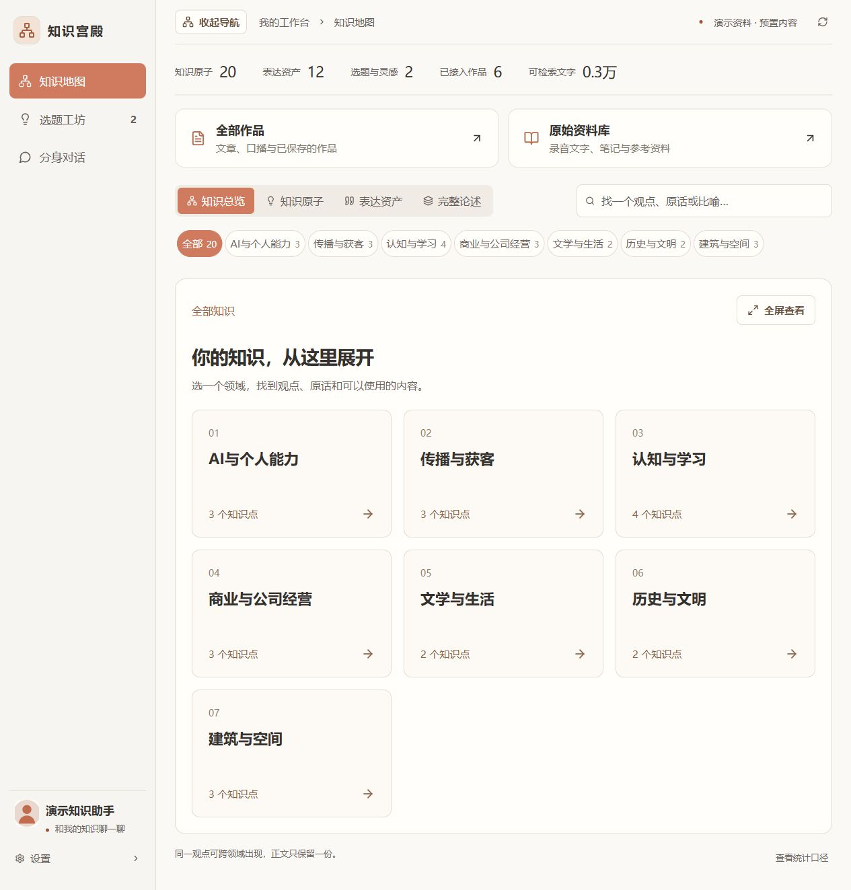
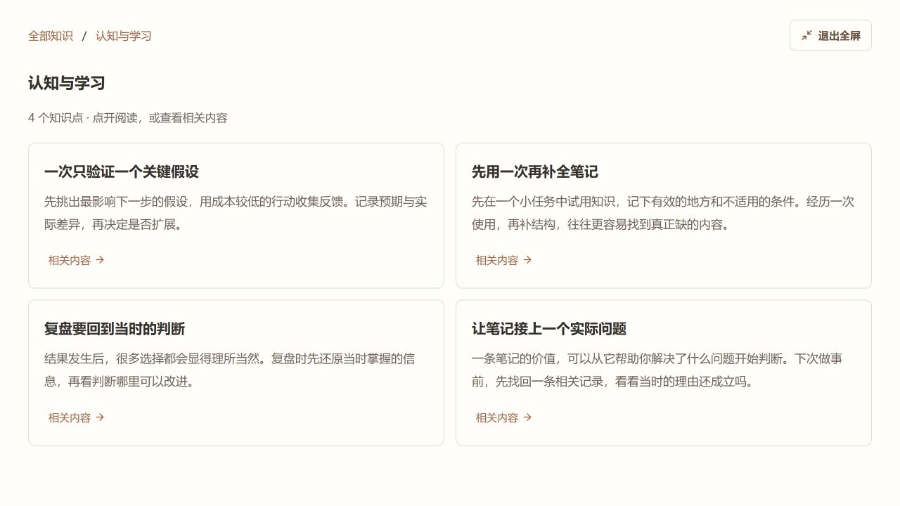
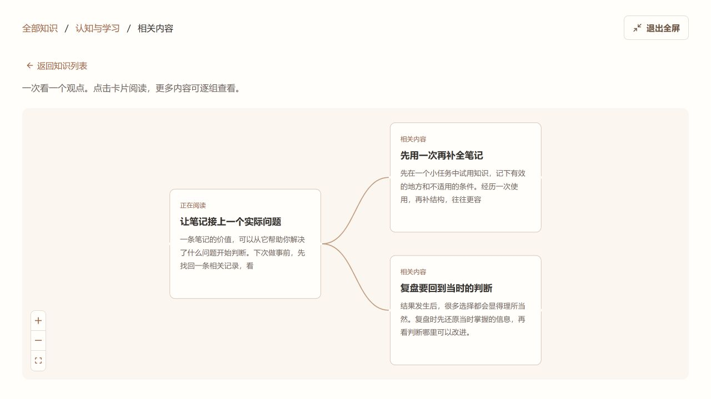
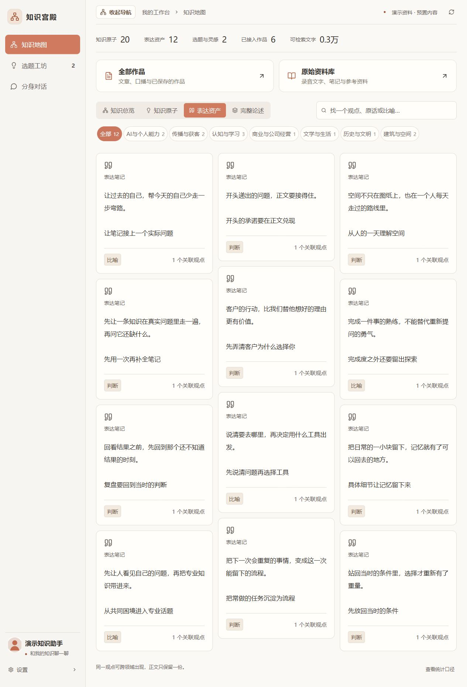
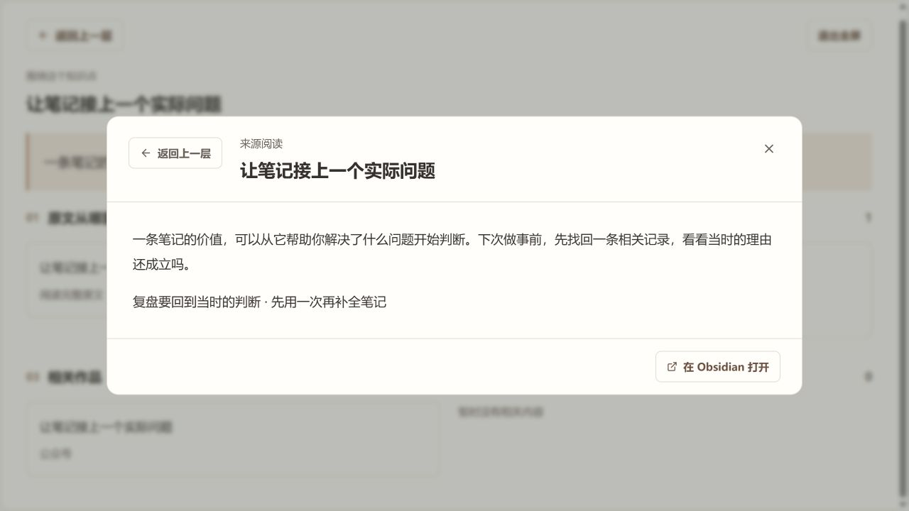
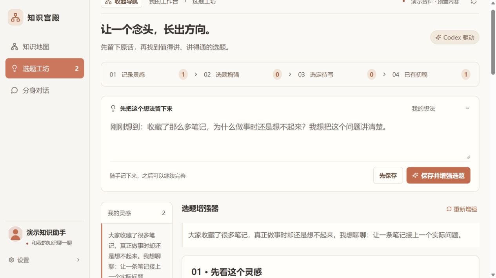
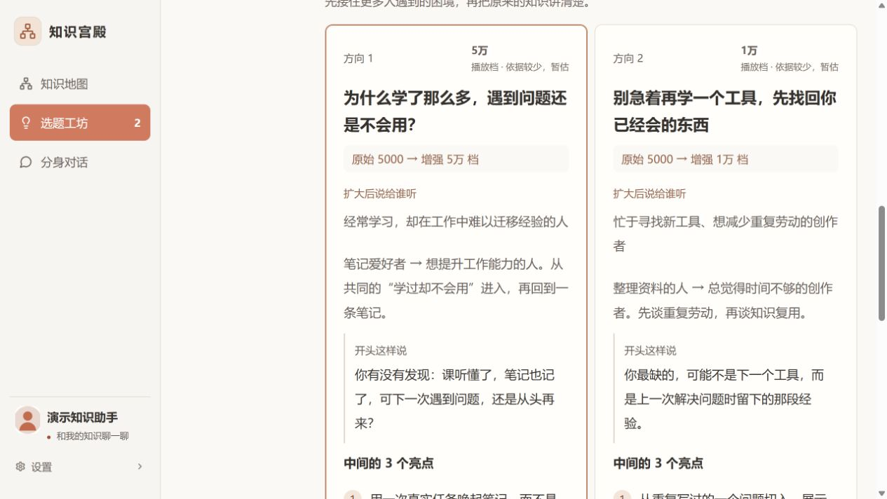
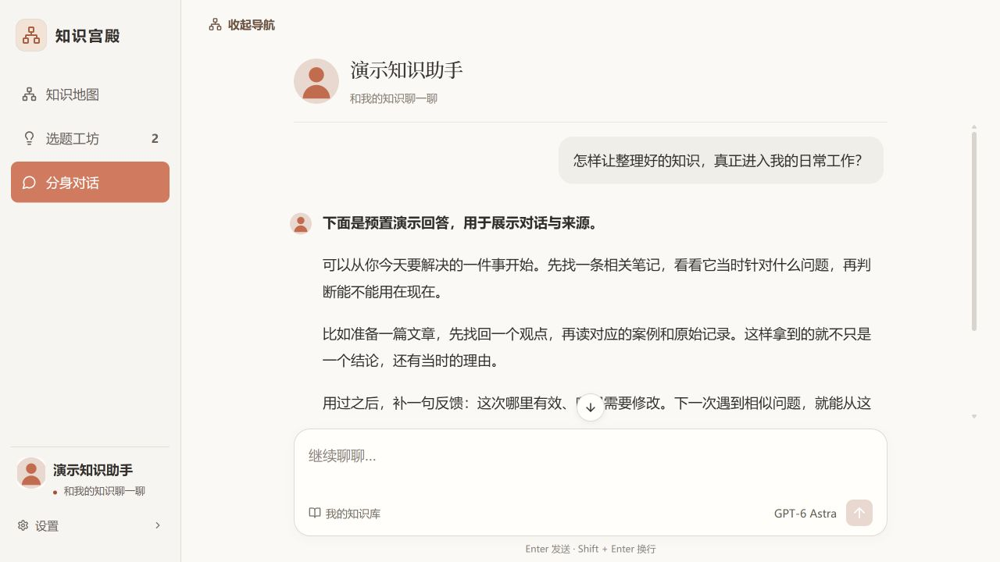

<div align="center">

# YL 知识工作台

**让知识，连成你的能力。**

把 Obsidian 中的观点、原话、作品与灵感，放进一个看得清、读得顺、用得上的工作台。

[](https://github.com/LeoAI1988/yl-knowledge-workbench/releases/latest)
[](LICENSE)
[](https://obsidian.md)

[下载安装包](https://github.com/LeoAI1988/yl-knowledge-workbench/releases/latest) · [五分钟上手](docs/quickstart.md) · [完整操作图册](docs/gallery.md) · [YL Skills](https://github.com/LeoAI1988/yl-skills)

</div>



## 为什么做这个插件

知识库管理的终极目的是使用。可是，资料越多，文件夹越深，图谱上的线越密，找一个观点反而越来越费劲。

YL 知识工作台在原有 Markdown 和双向链接之上加了一层阅读与使用界面：先按领域找到内容，再沿着一个观点看关联、读来源，随时带进对话或选题。暖白底色、少量陶土橙、大一点的文字，尽量让注意力留在内容上。

## 一条看得懂的使用路径

**找到观点 → 看清关联 → 读回原文 → 留下灵感 → 比较方向 → 形成初稿。**

| 你想做什么 | 工作台怎样帮你 |
|---|---|
| 找到自己的知识 | 按领域筛选观点、方法、案例；搜索标题与卡片内容 |
| 弄清知识之间的联系 | 聚焦一个观点看少量关联；顺着阅读卡继续打开相关内容 |
| 找回自己的表达 | 表达资产按领域展示，长短卡片自然排列，可回到关联观点 |
| 读作品和原始资料 | 首页直接进入两个资料库，搜索、分类、打开正文、返回上一层 |
| 加工一个粗糙想法 | 先拆解受众，再生成 2—3 个方向，给出开头、至少三个亮点、结尾和承接动作 |
| 与知识库对话 | 检索本地材料后交给已登录的 Codex 推理，回答附可展开的来源 |

### 知识不是一团线




### 原话和表达，随手就能找到




### 从一个念头，到几个值得讲的方向




### 和自己的知识聊一聊



**以上均为运行界面的实拍截图，使用仓库附带的虚构演示资料。** 选题分析、初稿和问答内容为预置示例，用于展示交互，不是一次真实模型生成或流量验证。更多步骤见 [完整操作图册](docs/gallery.md)。

## 安装

当前为 **v0.3.0 桌面试用版**，已在 Windows + Obsidian 桌面验证。未上架 Obsidian 社区插件市场；不支持手机。macOS / Linux 的代码路径保留，尚未实机验证。

1. 安装 **Python 3.12 或以上**，执行一次 `python -m pip install "PyYAML>=6,<7"`。
2. 从 [Releases](https://github.com/LeoAI1988/yl-knowledge-workbench/releases/latest) 下载 `yl-knowledge-workbench-0.3.0.zip`，解压。
3. 将整个 `yl-knowledge-workbench` 文件夹放进库的 `.obsidian/plugins/`。**必须包含 backend 文件夹**，只复制三个插件文件不能运行。
4. 在 Obsidian「设置 → 第三方插件」启用「知识工作台」。插件设置填写 Python 可执行文件的完整路径，点击「应用并打开」。

日常点击侧栏网络图标即可。Windows 使用 `pythonw.exe` 在后台启动，不需要保留终端窗口。首次安装需要配置环境，后续打开不用重复操作。

问答、选题增强和写初稿还需要 **本机 Codex 已登录、模型权限及可用额度**。默认模型 ID 是 `gpt-6-astra`，可改成自己账号可用的模型。没有 Codex，仍可浏览、阅读和保存灵感。推理经过 Codex 云端服务，并非离线运行 GPT。

[详细安装、升级与故障处理 →](docs/quickstart.md)

## 用自己的资料跑通一次

普通 `.md` 文件会进入原始资料库。要让某篇笔记显示为知识原子，可以在 Obsidian 属性中添加：

```yaml
---
type: OPI
title: 复盘要回到当时的判断
domains: [认知与学习]
---
```

正文保存完整观点，用 `[[另一篇知识笔记]]` 建立真实链接。`OPI` 是观点，`SOL` 是方法，`CON` 是概念，`CAS` 是案例；`expression` 是表达资产，`work` 是作品。领域由你决定，可填多个。没有填写领域则进入「待归类」。

属性是显示约定，**填写属性不等于已经完成蒸馏或作者核验**。普通库使用本地文字检索，不会自动把全部笔记变成知识原子。可先打开 [演示库](examples/demo-vault) 了解格式。

## YL、Obsidian 和工作台各做什么

```text
录音 / 笔记 / 文稿 / 外部资料
            ↓
YL Skills：保留原件 → 判断归属与版本 → 阅读原文 → 蒸馏与去重
            ↓
原始资料 ←→ 知识原子 ←→ 表达资产 ←→ 思想结构 / 作品
            ↓
Obsidian + YL 工作台：浏览、追溯、检索、讨论、选题、初稿
```

[YL Skills](https://github.com/LeoAI1988/yl-skills) 中的 `yl-knowledge` 协调完整知识处理。这个插件把处理结果变成可读、可用的界面。两者各自安装；插件没有在后台自动调用整套 Skills。

已有本项目 YL 数据结构的用户可以接入现有 profile，保留原检索与历史作品数据。其他 YL 库若结构不同，需先适配；不要复制作者的配置。普通库可独立使用，不依赖作者的原文件、头像或私人知识。

[完整入库与调用机制 →](docs/workflow.md)

## 能力与当前限制

| 功能 | 普通 Markdown 库 | 已适配的 YL 库 |
|---|---|---|
| 资料阅读、明确类型的知识卡、领域、双向链接 | 支持 | 支持 |
| 资料检索 | 本地文字检索 | 按已有配置使用全文与语义检索 |
| 问答、选题增强、初稿 | 需 Codex | 需 Codex |
| 完整论述与历史播放/涨粉/完播/成交 | 尚无通用导入器 | 读取已有登记数据 |
| 正式蒸馏入库 | 通过 YL Skills 或人工整理 | 通过 YL Skills |
| 实时热度、平台采集/发布、公开分身服务器 | 本插件未实现 | 本插件未实现 |

播放量档位是编辑暂估，未校准预测准确率，不能保证播放或成交。普通库没有历史表现数据时，预估依据会标为不足。

## 数据与维护

- 原文保存在自己的库。开源包不含作者的知识、头像、账户、聊天或经营数据。
- 模型只在触发相关操作时接收本次材料与近期对话；详见 [隐私与存储](docs/privacy.md)。
- 插件关闭后后台可继续供本机浏览器使用；未添加系统开机自启。
- 原创代码使用 MIT 许可证；第三方依赖见 [许可说明](THIRD_PARTY_NOTICES.txt)。独立 YL Skills 项目按其自身许可使用。

[开发与验证](docs/development.md) · [更新记录](CHANGELOG.md) · [参与贡献](CONTRIBUTING.md) · [反馈问题](https://github.com/LeoAI1988/yl-knowledge-workbench/issues/new/choose)

