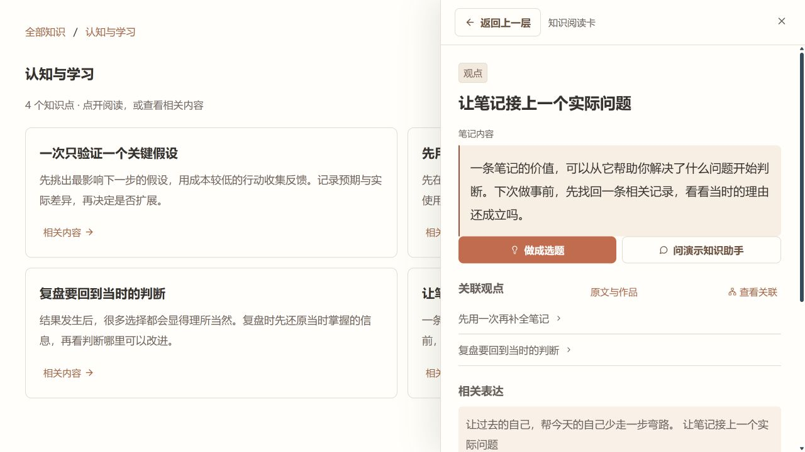
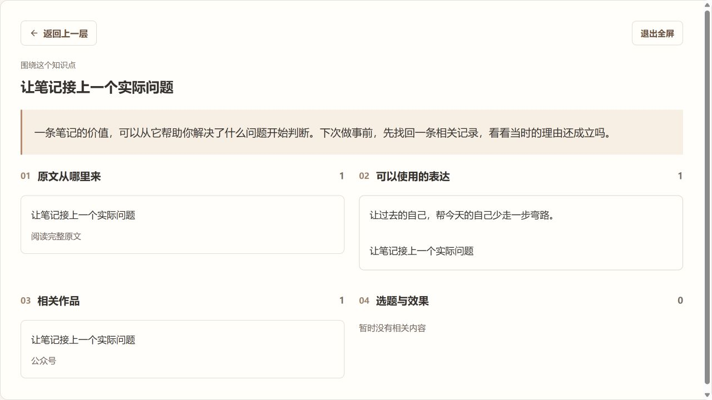
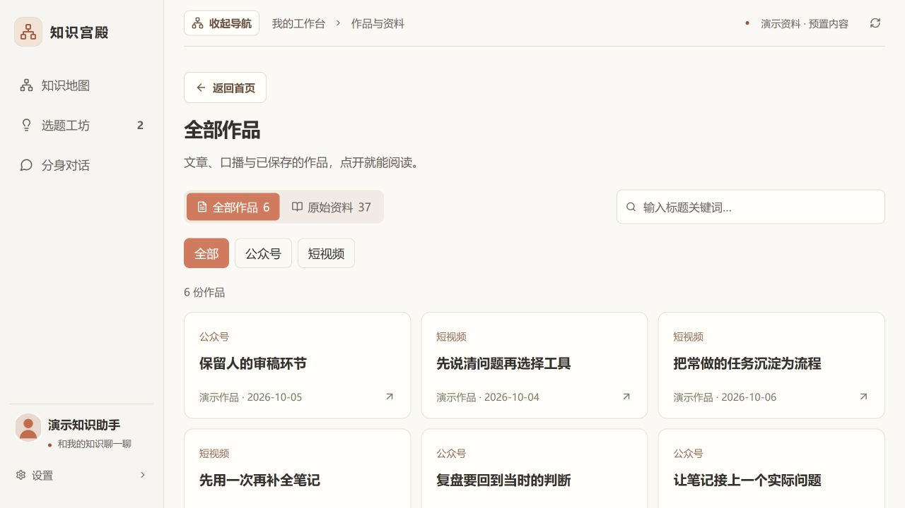
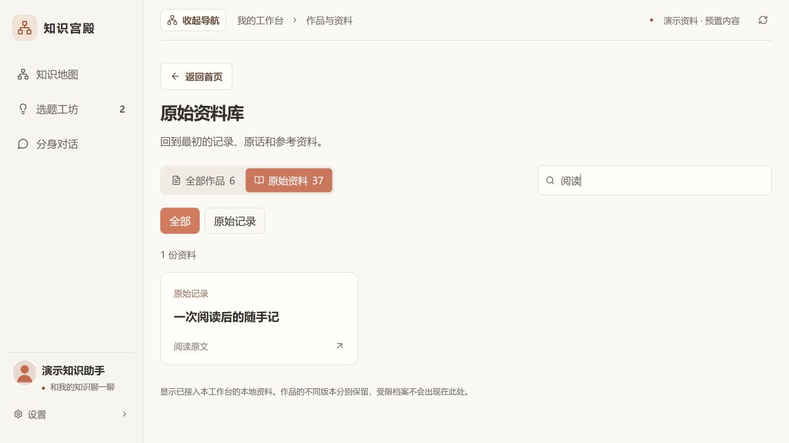
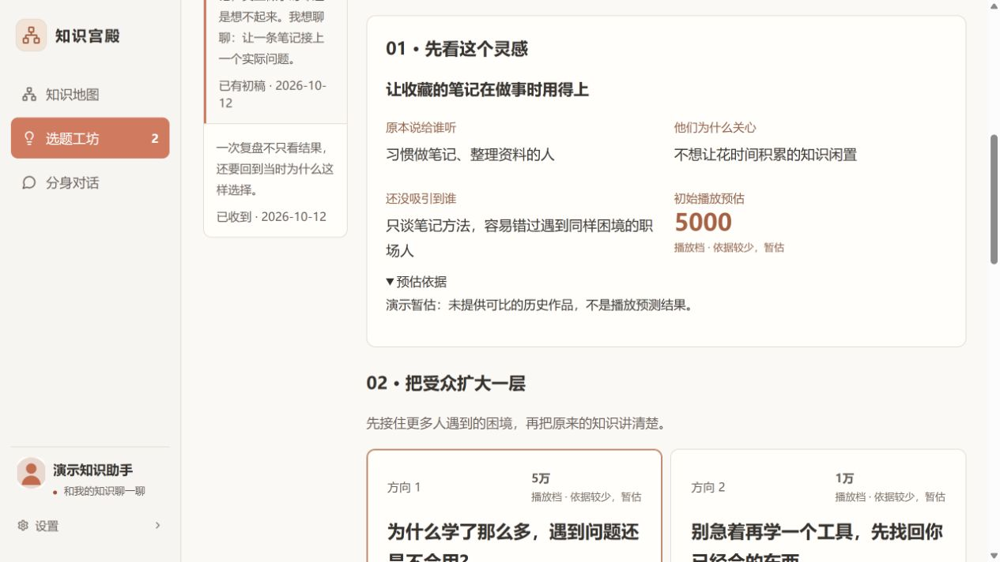
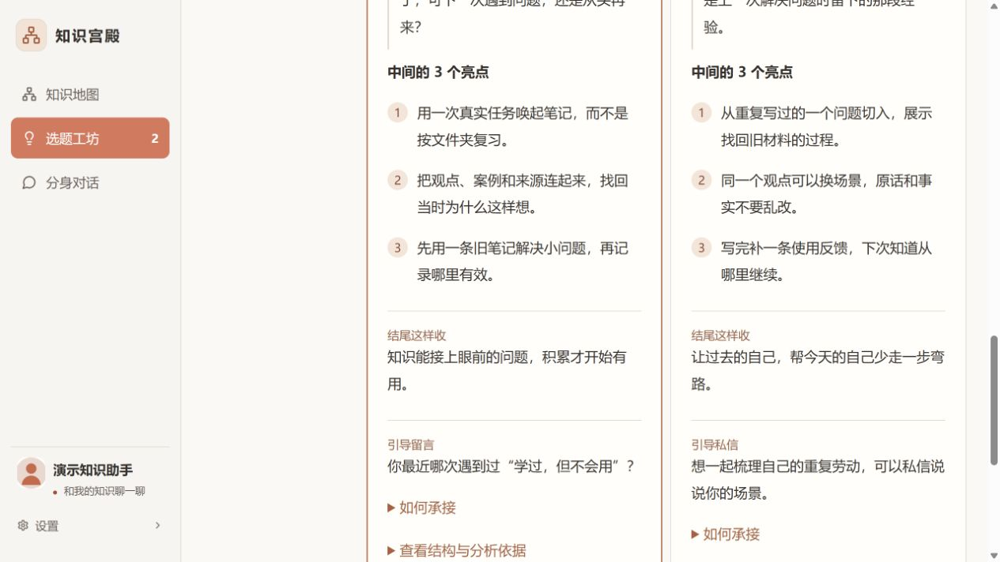
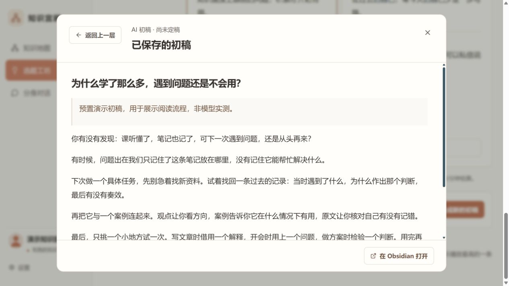
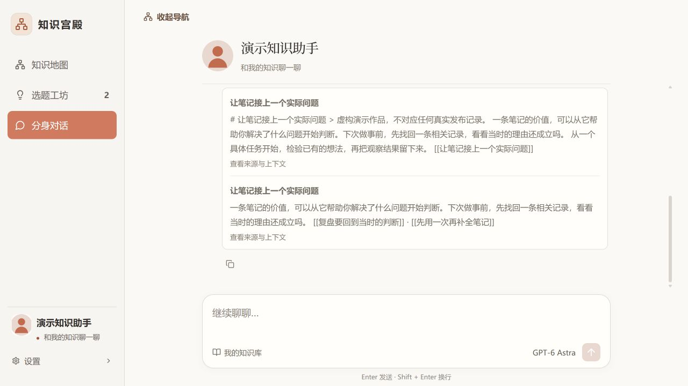

# 跟着 16 张截图走一遍

全部来自真实运行的工作台，使用仓库的虚构演示库。选题、播放档位、初稿和问答为预置示例，展示的是交互流程，不是模型实测或真实经营数据。

## 1. 从这里开始

首页按领域进入知识，同时看到知识、表达、作品的数量和资料库入口。

## 2. 缩小范围

选择认知与学习，四个相关知识点直接呈现。点击全屏，给内容更多空间。

## 3. 点开就读

右侧阅读卡先显示观点正文，再给关联、表达和来源；返回上一层保持浏览位置。

## 4. 一次看清一组联系

关系图聚焦一个知识点和少量相关内容。自然曲线和缩放帮助追踪，不铺满全库连线。

## 5. 把相关内容串起来

从一个观点继续看原文、表达和作品。没有接入的历史效果保持空白。

## 6. 回到原文核对

点击来源即可读正文，需要编辑时再跳到 Obsidian。

## 7. 找回合适的说法

表达按领域过滤，卡片随内容长短排列，可进入关联知识。

## 8. 作品单独成库

文章与口播按平台筛选，点标题阅读。演示作品不对应真实发布。

## 9. 直接找到那份资料

输入标题关键词，快速定位原始记录，不必翻一层层目录。

## 10. 先留下粗糙念头

记录原话和归属，选择先保存或保存并增强。进度只统计当前阶段。

## 11. 先拆受众

先看原本说给谁、为什么关心、还没吸引到谁。无历史依据会明确标注。

## 12. 再比较扩大方向

比较更广受众与开头，各方向保留原意。播放档位是演示暂估，不是流量保证。

## 13. 亮点与结尾一起想

每个方向至少三个不同亮点，再设计结尾和留言/私信承接。

## 14. 选定后进入初稿

草稿独立保存，可读、可返回；未定稿不会自动发布或变成本人原话。

## 15. 直接与知识讨论

对话界面把注意力放在问题和回答上；截图答案为预置演示。

## 16. 看回答从哪里来

展开引用来源，再读上下文。显示来源不等于每一句已经事实核验。

[安装并试用](quickstart.md) · [返回首页](../README.md)

